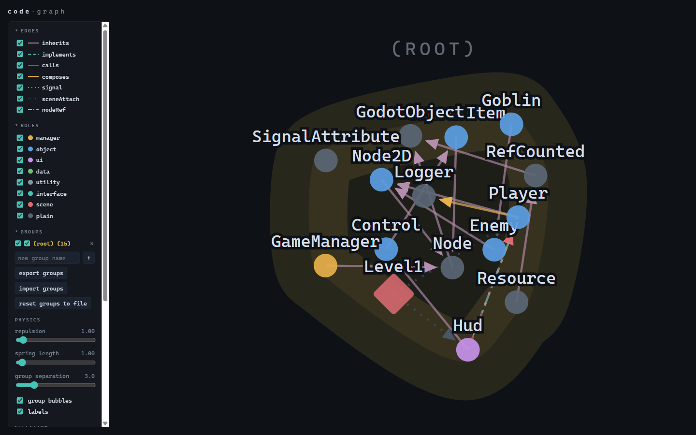

# codegraph

Code relationship visualization for Godot 4 C# projects.



Two halves:

1. **extractor/** — Roslyn console tool. Loads your `.csproj`/`.sln`, walks the semantic
   model, parses `.tscn` files and `project.godot`, and emits a single `graph.json`.
2. **viewer/** — a single `index.html` using d3-force, served by `serve.py`. Physics
   playground: nodes repel, edges act as springs with a minimum rest length, groups
   repel each other and push away non-members, drag anything, per-node repulsion
   override, group bubbles, edge-kind styling, role color coding, node size by file
   size. Multi-membership groups (add/rename/delete/hide, per-node or per-group) are
   editable live and persisted to `localStorage` per session. "export groups" writes
   a `{"groups": {...}}` snippet in the same shape as `codegraph.config.json`'s
   `groups` key (paste it in there and re-extract to bake edits into `graph.json`
   permanently); "import groups" reads that same snippet straight back into the
   live session without a re-extract, merging it into whatever groups are already
   loaded. "reset groups to file" discards session/live group edits and rebuilds
   groups from the currently-loaded `graph.json`'s own `groups` field — use it if a
   stale browser session is shadowing groups you just baked in via a fresh
   `--config`+re-extract (session groups always take precedence over the file's on
   load, by design, so in-progress edits survive a refresh).

## Quick start

```bash
# Extract (requires .NET 8 SDK; run from anywhere)
cd extractor
dotnet run -- /path/to/YourGame.csproj --root /path/to/godot/project --out /path/to/graph.json

# View
cd ../viewer
python serve.py        # http://localhost:8420/ -- fixed port, run once
```

`serve.py` serves the viewer statically and adds `GET /api/graph?path=<absolute path>`,
so you don't have to copy each project's `graph.json` next to `index.html`: paste the
absolute path into the "load" box in the Data section once, and the viewer remembers it
(along with your groups/physics settings) in `localStorage` and reloads it automatically
next time you open the page. Binds to `127.0.0.1` only.

The viewer also still accepts a `graph.json` via the file picker or drag-and-drop (no
path memory for those — browsers don't expose a re-fetchable path for a dropped file),
or you can open `index.html` directly from disk with no server at all, though `file://`
blocks `fetch()` so it'll fall back to a small embedded sample instead of any
`graph.json` sitting next to it.

## graph.json schema (v1)

```jsonc
{
  "meta": {
    "schemaVersion": 1,
    "generatedAt": "2026-07-20T00:00:00Z",
    "projectRoot": "/abs/path/to/godot/project"
  },
  "nodes": [
    {
      "id": "MyGame.Player",            // fully qualified type name, or "scene:<relpath>"
      "label": "Player",
      "kind": "class",                  // class | interface | struct | enum | scene
      "file": "scripts/actors/Player.cs", // relative to projectRoot; scenes: the .tscn path
      "bytes": 4821,                    // summed across partial-class files
      "loc": 176,                       // non-empty lines, summed across partials
      "role": "object",                 // manager | object | ui | data | utility | interface | scene | plain
      "groups": ["actors"],             // grouping keys (directory / namespace / override); usually one, can be several
      "isStatic": false,
      "baseType": "CharacterBody2D",    // immediate base, display name
      "godotBase": "Node",              // nearest Godot ancestor category: Node|Control|Resource|RefCounted|GodotObject|null
      "signalsDeclared": ["HealthChanged"],  // [Signal] delegates (EventHandler suffix stripped)
      "signalsEmitted": ["HealthChanged"],   // EmitSignal / EmitSignalX call sites found in this type
      "scenes": ["scenes/player.tscn"]  // scenes this script is attached to
    }
  ],
  "edges": [
    // kind semantics:
    //  inherits    A : B (both project types)
    //  implements  A : IB
    //  calls       method invocation or object creation; weight = call-site count
    //  composes    field/property holds a project type (incl. one level of generic args)
    //  signal      A listens to a signal/event declared on B ("signal" field = name).
    //              Sources: C# `+=` on [Signal]-generated events and plain C# events,
    //              Connect(...) calls, and .tscn [connection] entries.
    //  sceneAttach scene:<path> -> script type attached in that scene
    //  nodeRef     GetNode<T>/GetNodeOrNull<T>/FindChild-style typed scene lookups
    { "from": "MyGame.Player", "to": "MyGame.IDamageable", "kind": "implements" },
    { "from": "MyGame.Player", "to": "MyGame.Inventory",   "kind": "calls", "weight": 7 },
    { "from": "MyGame.HUD",    "to": "MyGame.Player",      "kind": "signal", "signal": "HealthChanged" }
  ]
}
```

Notes on the abstraction (deliberate imprecision):

- Multiple types in one file each report the full file's bytes/LOC. Fine for a size
  *impression*; don't treat it as a metric.
- Signal edges point listener → declarer. Emission is recorded as node metadata
  (`signalsEmitted`) rather than edges, because the emitter usually doesn't know its
  audience — that decoupling is the point of signals, and the graph reflects it.
- Plain C# `event` subscriptions are also emitted as `signal` edges: architecturally
  they play the same role. If you want them distinguished, split the kind in
  `RoslynExtractor.cs` where the `+=` handler is resolved.
- Object creation (`new Foo()`) is folded into `calls` weight.

## codegraph.config.json (optional, `--config`)

```jsonc
{
  "groupBy": "directory",          // "directory" (default) | "namespace"
  "groupDepth": 2,                 // path segment used when groupBy=directory (0-based)
  "groupNestDepth": 1,             // directory levels below groupDepth that also become
                                   // nested groups, e.g. "systems/shipgen" (0 = off)
  "minNestedGroupSize": 2,         // drop smaller nested groups (and ones identical to their parent)
  "roles":  { "MyGame.AudioDirector": "manager" },   // per-type overrides
  "groups": { "MyGame.SaveService": ["infrastructure", "core"] }, // a node can be in more than one group
  "rolePathPrefixes": { "scripts/ui/": "ui", "scripts/data/": "data" },
  "exclude": ["test/", "addons/gdUnit4/"]
}
```

Role heuristics without overrides: autoloads in `project.godot` → `manager`;
nearest Godot base `Resource` → `data`, `Control` → `ui`, `Node` → `object`;
static classes → `utility`; interfaces → `interface`; everything else → `plain`.

`exclude` is a list of relative path prefixes (forward-slash, case-insensitive,
matched from the project root) to leave out entirely — no node, no edges, no
`.tscn` scan. Useful for test suites and vendored addons that would otherwise
compile into the graph and add noise unrelated to your game's architecture.

## Known fiddly bits / TODOs

- **Cross-scene signal resolution.** `.tscn` `[connection]` entries are resolved to the
  scripts attached to the named nodes *within the same scene file*. Connections to
  nodes deeper in instanced sub-scenes are skipped (logged to stderr).
- **Generics / extension methods.** Call edges resolve through the semantic model, so
  most generic instantiations land on the right type, but exotic cases (reflection,
  `Callable.From` indirection, `CallDeferred("method_name")` string calls) are invisible.
- **Source generators.** Godot's generated partials (`*.g.cs` under `obj/`) are excluded
  from size counts and syntax walking; their symbols still participate in resolution.
- **First run of MSBuildWorkspace** needs the same .NET SDK your Godot project targets;
  watch stderr for `[workspace]` diagnostics if the load is incomplete.
- **Grouping is directory- or namespace-based only.** `Classifier.ResolveGroup` picks a
  single path/namespace segment, which only produces a meaningful grouping when the
  project's folder (or namespace) structure is fairly disciplined. Loosely organized
  projects end up with arbitrary or noisy groups. Config `groups` overrides exist as an
  escape hatch per-node, but there's no bulk/rule-based way to define groups (e.g. by
  base type, by role, by tag, or interactively in the viewer). Worth revisiting —
  possibly viewer-side manual grouping/regrouping, or additional grouping strategies
  in `Classifier`.

## License

MIT — see [LICENSE](LICENSE).
